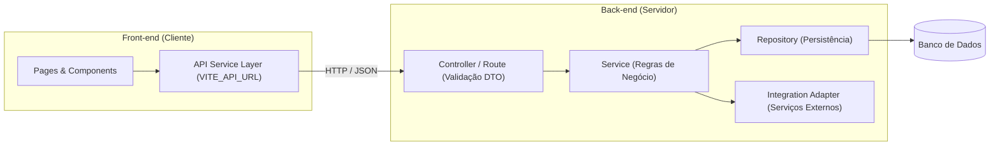

# Guia Técnico: Arquitetura de Software e Organização de Sistemas

## 1. Visão Geral e Conceitos Fundamentais

A **Arquitetura de Software** define como um sistema é dividido em módulos ou camadas, quais são as responsabilidades de cada parte e como elas se comunicam mantendo baixo acoplamento e alta coesão.

### Princípios Estruturais (SOLID e Separação de Preocupações)
- **SRP (*Single Responsibility Principle*):** Cada módulo, classe ou componente deve ter apenas uma razão de negócio para mudar.
- **OCP (*Open/Closed Principle*):** Módulos devem ser abertos para extensão de comportamento sem exigir modificação destrutiva em contratos já estáveis.
- **LSP (*Liskov Substitution Principle*):** Implementações de uma interface devem respeitar integralmente o contrato esperado pelos consumidores.
- **ISP (*Interface Segregation Principle*):** Prefira interfaces enxutas e focadas em vez de interfaces gigantescas.
- **DIP (*Dependency Inversion Principle*):** Regras de negócio de alto nível não devem depender diretamente de detalhes de infraestrutura de baixo nível (bancos, clientes HTTP externos).

---

## 2. Padrões Arquiteturais em Projetos Front-end e Back-end

### 2.1. Arquitetura Front-end (React / TypeScript / Vite)
Em aplicações cliente, recomenda-se separar claramente as responsabilidades:
- **`pages/` ou `views/`:** Componentes de rota que conectam parâmetros de URL e coordenam o layout da tela.
- **`components/`:** Componentes visuais reutilizáveis (botões, modais, tabelas, inputs) desacoplados de rotas específicas.
- **`services/` ou `api/`:** Camada dedicada à comunicação HTTP (`fetch` / `axios`), centralizando `VITE_API_URL`, cabeçalhos de autenticação e tratamento padronizado de respostas.
- **`hooks/` e `contexts/`:** Lógica compartilhada de estado e ciclo de vida (ex.: `useAuth`).
- **`types/` e `utils/`:** Contratos TypeScript e funções puras de formatação/validação.

> **Regra Arquitetural:** Componentes visuais genéricos não devem fazer chamadas `fetch('/api/...')` diretamente; devem receber dados e *callbacks* via `props` ou consumir a camada de serviços/hooks apropriada.

### 2.2. Arquitetura em Camadas / Modular no Back-end
- **Camada de Apresentação (`Controllers` / `Routes`):** Recebe a requisição HTTP, valida o formato do DTO de entrada, aciona a camada de serviço e devolve o DTO de saída com o status HTTP adequado. **Não deve conter regras de negócio nem SQL.**
- **Camada de Aplicação / Domínio (`Services` / `UseCases`):** Orquestra as regras de negócio, valida permissões de domínio, coordena transações e chama repositórios ou integrações.
- **Camada de Persistência e Infraestrutura (`Repositories` / `Adapters`):** Isola o acesso ao banco de dados (SQL/ORM) e clientes de APIs externas (ex.: Gmail, WhatsApp).

---

## 3. Diagrama de Fluxo e Separação de Responsabilidades

---

## 4. Erros Arquiteturais Comuns e Como Evitá-los

| Erro Arquitetural | Problema | Solução Recomendada |
| :--- | :--- | :--- |
| **Regras de negócio espalhadas no Controller ou na View** | Dificulta testes unitários e gera duplicação quando a mesma regra precisa ser usada em outra tela ou endpoint. | Centralizar regras de negócio na camada de `Service` / domínio no back-end e em funções/hooks dedicados no front-end. |
| **Acoplamento direto a integrações externas** | Chamar APIs de terceiros diretamente dentro do Controller sem um *Adapter* quebra todo o sistema se o fornecedor mudar o formato. | Isolar integrações externas atrás de uma interface/serviço adaptador com tratamento de timeout e falhas. |
| **Dependências Circulares (`Módulo A` importa `B` e `B` importa `A`)** | Causa erros de inicialização (`undefined` em tempo de importação) e impede *refactoring* modular. | Extrair os tipos ou funções compartilhadas para um terceiro módulo base (`common` / `types`). |
| **Substituir a arquitetura existente do projeto sem necessidade** | Gera inconsistência entre módulos feitos por diferentes membros da equipe. | Respeitar a arquitetura já adotada no repositório e registrar mudanças relevantes via ADR (*Architecture Decision Record*). |

---

## 5. Referências Técnicas

- **Martin Fowler — Software Architecture Guide:** https://martinfowler.com/architecture/
- **C4 Model for Visualizing Software Architecture:** https://c4model.com/
- **Architectural Decision Records (ADR):** https://adr.github.io/

